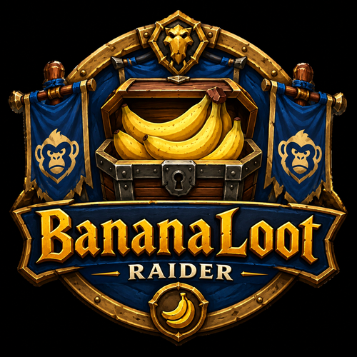

<p align="center">
  <a href="assets/BananaLootRaider.png"></a>
</p>

# 🍌 BananaLoot Raider

**Lightweight companion addon to [BananaLoot](https://github.com/BaregBananenrepublik/BananaLoot) for raiders** (no master loot) – for World of Warcraft Classic 1.12 (OctoWoW, Turtle WoW, and similar Vanilla servers)

Part of [BananaForge](https://github.com/BananaForge).

**⬇️ [Download the latest version](https://github.com/BaregBananenrepublik/BananaLoot-Raider/releases/latest)**

---

## What is BananaLoot Raider?

BananaLoot Raider is **not** a standalone master loot addon. It never keeps
its own soft-reserve list, never awards items, and needs no master loot
permission for any of that. It only adds raider-side convenience for a raid
whose loot master runs [BananaLoot](https://github.com/BaregBananenrepublik/BananaLoot):

- Receives BananaLoot's optional Roll-Sync broadcast (item, countdown,
  incoming rolls) in its own popup window with direct MS/OS/TM roll buttons
- Shows a shared, session-local loot history fed by the same broadcasts
- Offers a small send window to whisper `sr [Item]`/`unsr [Item]` to the
  loot master via shift-click, instead of dragging the item link into chat
  by hand
- Optionally detects hand-offs of BananaLoot-awarded items in your own
  trade window and makes them visible to everyone with trade tracking
  enabled

No SR window, no loot window, no management, no export/import, and no own
loot log – all of that stays the loot master's job. Both addons install
side by side without conflicting (separate SavedVariables, separate item
database table, separate slash command).

---

## Features

### Roll-Sync popup

- Opens automatically whenever a BananaLoot loot master in your
  raid/group starts a roll with Roll-Sync enabled
- Shows item icon and name, mode (SR/Open/ARF), a live countdown, and a
  live standings list of incoming rolls (sorted by category priority –
  Main Spec beats Off-Spec beats Transmog, then by roll value)
- Three buttons (MS/OS/TM) to roll directly from the window (same effect
  as typing `/roll`, `/roll 1 99`, `/roll 1 98` by hand)
- If the loot master runs Round-Robin Main Spec, Main Spec rolls are
  tagged with their RR stage (`RR1`, `RR2`, ...); rolls with a higher
  stage than the current lowest don't count and are greyed out with a
  red X, with a legend shown automatically
- On a tie, the list resets and the countdown restarts; on a winner, the
  result is highlighted and the window closes itself after a few
  seconds; on a cancellation it closes immediately
- Can be turned off entirely in Options. Without a BananaLoot loot
  master in the raid, or without their option enabled, nothing happens –
  normal `/roll`-based play is completely unaffected

### Shared loot history

- `/blr` shows a simple list (time, item, winner, category) of every
  award in the current session, fed by the same broadcasts as the
  Roll-Sync popup
- Session-only, not saved to disk. Bank Reserve awards never appear
  here, by design

### SR/unSR via shift-click

- `/blr sr` opens a small window with a name field for the loot master
  and an item field
- Shift-click an item into the item field, enter the loot master's name
  (exact spelling matters), click "send sr" / "send unsr" – sends
  exactly the whisper you'd otherwise type by hand (`sr [Item]` /
  `unsr [Item]`)
- The loot master's reply comes back as a normal whisper and isn't
  parsed or acted on by BananaLoot Raider

### Trade tracking (optional, default: on)

- Detects hand-offs of BananaLoot-awarded items in your **own** trade
  window: remembers the last known owner of every awarded item (fed by
  the same award broadcasts as the loot history) and checks every trade
  you complete against it
- If either side of your own trade matches a known item, BananaLoot
  Raider reports the hand-off via chat and broadcasts it as an addon
  message to every other trade-tracking-enabled user in the
  raid/group – the message already reaches everyone in the channel in
  one step, no manual relaying needed
- This keeps hand-offs traceable across multiple players, as long as at
  least one side of each trade has trade tracking enabled. BananaLoot
  Raider keeps no own loot log, only the last known owner per item –
  that stays the loot master's job

### Static item database

- Ships with the same static item database as BananaLoot (~14,230
  entries, sourced from Bananaforge Luminar – see
  [Credits](#-credits)), so items in the Roll-Sync popup and loot
  history show a real name, correct quality color, and correct icon
  immediately, even if your own client has never seen the item
- Items not in the database fall back to "Item #ID" and a placeholder
  icon until they actually drop in the raid

### Other

- Draggable minimap button (left-click: loot history, shift-left-click:
  SR send window, right-click: options)
- Options: Roll-Sync, trade tracking, language (German/English, one
  click), UI scale for popup/history/SR window (50–150%), individual
  sound toggles (roll started / winner determined / button clicks, plus
  one master switch)

---

## Installation

### Via the OctoLauncher (git-based)

The [OctoLauncher](https://octowow.st/git/OctoWoW/OctoLauncher) manages
addon installations git-based. If your launcher (or a fork of it) lets you
add a custom addon repository, point it at:

```
https://github.com/BaregBananenrepublik/BananaLoot-Raider
```

The launcher then pulls the current state directly from this repository
and keeps future commits in sync automatically, without you ever having
to extract anything by hand. Whether your specific launcher build exposes
an "add custom repository" option depends on its version – check its UI
for something like "Add addon" / "Custom repository". Appearing
automatically in the launcher's own curated addon catalog for every player
(without anyone adding it manually) is outside this repository's control
and would need to be coordinated separately with the OctoWoW/launcher
team.

### Manual (ZIP)

1. Download `BananaLoot-Raider-<version>.zip` from the
   [latest release](https://github.com/BaregBananenrepublik/BananaLoot-Raider/releases/latest)
2. Extract it into `World of Warcraft/Interface/AddOns/` – you should end
   up with `Interface/AddOns/BananaLootRaider/BananaLootRaider.toc`
3. Restart the client or `/reload`
4. Keep it enabled under "AddOns" on the character selection screen

### Manual (directly from this repo)

> **Don't use GitHub's green "Code → Download ZIP" button without
> renaming the result.** It produces a folder called
> `BananaLoot-Raider-main`, and the client then finds neither the addon
> nor its icons.

1. Download this repository via **Code → Download ZIP**
2. Rename the extracted folder to `BananaLootRaider` and copy it into
   `World of Warcraft/Interface/AddOns/` – the folder name must match the
   `.toc` file exactly
3. Restart the client or `/reload`

The addon can be switched from German to English with a single click
under Options.

---

## Key commands

| Command | Effect |
|---|---|
| `/blr` | Open/close the shared loot history |
| `/blr sr` | Open the SR send window (sr/unsr via shift-click) |
| `/blr options` | Open settings |
| `/blr help` | Show the command legend |

Full command overview is also available in-game via the **?** button in
the loot history's title bar.

---

## Honestly: limitations of this addon

- **Roll-Sync and trade tracking only work between BananaLoot/BananaLoot
  Raider users.** They're purely client-side addon-message features with
  no server component; a loot master without Roll-Sync enabled, or a
  trade partner without trade tracking enabled, is invisible to them.
- **No own SR list.** `sr`/`unsr` whispers go straight to the loot
  master, same as typing them by hand – BananaLoot Raider only fills in
  the item link for you.
- The static item database can't know about items added after it was
  last generated – those simply show as "Item #ID" until actually
  looted once, exactly like before the database existed.
- Tested primarily on OctoWoW/Turtle WoW – other 1.12 servers may differ
  in details.

---

## Technical details

- Pure Lua, no XML
- Compatible with Lua 5.0 (no `#` operator, no `string.gmatch`)
- Data is stored locally in
  `World of Warcraft/WTF/Account/<ACCOUNT>/SavedVariables/BananaLootRaider.lua`
  and survives relogs and patches

### Repository layout

```
BananaLootRaider.toc       Addon manifest (loaded when the AddOns folder is
                            named "BananaLootRaider")
BananaLoot-Raider.toc      Identical copy of the manifest above, named after
                            this repository, as a fallback for git-based
                            installs that clone into a folder matching the
                            repo name instead
BananaLootRaiderItemDB.lua Static item database (same data as BananaLoot,
                            renamed global table to avoid collisions)
BananaLootRaider.lua       Core: SavedVariables, locales, Roll-Sync receive,
                            trade tracking, slash commands
BananaLootRaiderUI.lua     Roll-Sync popup, shared loot history, SR send
                            window, minimap button
BananaLootRaiderExtra.lua  Options and command legend window
Icons/                     TGA textures loaded in-game
assets/                    Images for this README only (not shipped)
```

---

## Changelog

See [CHANGELOG.md](CHANGELOG.md).

---

## Author

**Bareg**

🍌 Made for my guild, the Bananenrepublik – part of [BananaForge](https://github.com/BananaForge) 🍌

---

## 🙏 Credits

- **[BananaLoot](https://github.com/BaregBananenrepublik/BananaLoot)** –
  the master loot addon this companion is built for; BananaLoot Raider
  receives its Roll-Sync and award broadcasts and uses the same message
  protocol.
- **Bananaforge Luminar** – source of the bundled static item database
  (`BananaLootRaiderItemDB.lua`), the same dataset shipped with
  BananaLoot itself. See [THIRD_PARTY_NOTICES.md](THIRD_PARTY_NOTICES.md)
  for details.

If your project or work should be credited here and isn't, please open an
issue – it wasn't intentional.

---

## License

Use at your own risk.

BananaLoot Raider's original source code and original artwork are
licensed under the [MIT License](LICENSE). The bundled item database
contains data sourced from Bananaforge Luminar. See
[THIRD_PARTY_NOTICES.md](THIRD_PARTY_NOTICES.md) for attribution and
source information.
